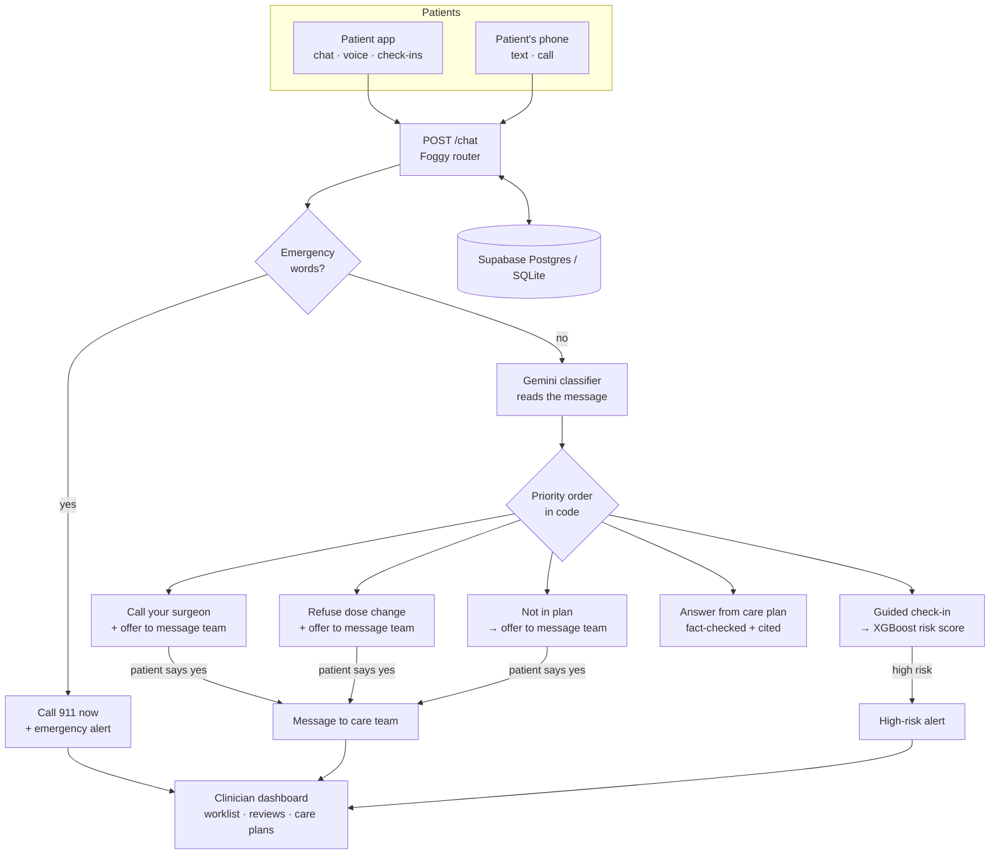

# ☁️ CloudCare

> **Your head's in the clouds. Your care shouldn't be.**

CloudCare is an AI-powered post-operative recovery companion. It brings the care team's instructions home, answers patients' questions **only** from what their clinician wrote, scores symptom check-ins with a machine-learning risk model, and brings in a human when it matters.

🌐 **Live site: [cloudcare.icu](https://cloudcare.icu)** (frontend on Vercel, API on Render, database and auth on Supabase)

> The landing page, including the "Try texting Foggy" demo and a recorded demo call, runs entirely in the browser. Login and the dashboards need the FastAPI backend to be reachable. See [Deployment](#deployment), or run everything locally with [Getting started](#getting-started).

---

## The problem

Patients get critical recovery instructions right after surgery, while they're still foggy from anesthesia. Then they're expected to remember everything and recognize when something is wrong. Many don't, and complications get caught late.

## The solution

| For patients | For clinicians |
|---|---|
| **Foggy**, a recovery assistant (text, voice, or a phone call) that answers from *their* care plan and cites the section it used | An **urgency-first worklist**: open emergencies first, then high alerts, kept separate from the ML risk estimate |
| A guided **check-in** with Foggy (pain, symptoms, and one question per medicine dose due today) that returns a recovery risk score | **Why** each patient was flagged: the top reasons behind each ML score |
| A clear "call 911" or "call your surgeon" instruction when the plan says so. Foggy **asks before** messaging the care team | A **review queue** to acknowledge and resolve alerts, with notes and who reviewed them |
| Medication and appointment **reminders**: tick off doses, or undo a mistake | **Care plans**: view a patient's plan, or paste in new instructions that Foggy uses immediately |
| **"Test on my phone"**: Foggy can text a check-in link or call for a spoken check-in, to the patient's own number only | **Patient profiles**: edit details, and claim new self sign-ups |
| **Connect MyChart (Epic)** to bring in medications, labs, visits and notes, read-only, and compare MyChart medications with the care plan | Search and filters, full chat transcripts and check-in history |
| Sign up, sign in and reset a password (Supabase Auth) | Role-based access: clinicians only see the patients assigned to them |

---

## Hackathon tracks

### 🤖 Ethical AI Agent
Foggy is designed so it **can't freelance medical advice**, and its full behaviour is written down in [`docs/foggy-policy.md`](docs/foggy-policy.md):
1. **Emergencies never depend on the AI.** Chest pain, trouble breathing, heavy bleeding and fainting are caught by rules *before* any model runs. The reply always starts with "Call 911 now", and nothing (a low pain score, "I feel fine", a change of subject) cancels it.
2. **The model classifies and phrases; code decides and acts.** A language model reads each message, but a fixed priority order in code picks what happens. Safety-critical replies use fixed wording, never generated text.
3. **It answers only from the clinician's care plan,** cites the section, and every answer is **fact-checked** against that section before the patient sees it. If the plan doesn't cover it, Foggy says so rather than guessing.
4. **Consent before contact.** Foggy *offers* to message the care team; nothing is sent unless the patient agrees to that specific action. A "yes" to a medicine question is never taken as permission to contact anyone.
5. **No dose changes, no diagnoses, no invented instructions.** Foggy refuses to change or stop a medicine and won't make up missing details, such as a missed-dose rule the plan doesn't contain.
6. **Honest about what it can do.** Foggy never claims a message was delivered or a call connected unless that's confirmed, and the app only offers features that are actually configured (`GET /chat/capabilities`).
7. **Humans close the loop.** Every alert is reviewed, noted and resolved by a clinician.
8. **Graceful degradation.** With no language model available, Foggy still routes and answers by rules (passing all 30 policy test cases), and if the risk model is missing, scoring falls back to rules.

### 📊 ML and Data Science
An **XGBoost** model predicts post-op complication risk from each check-in, and explains every score using per-feature SHAP contributions. See [Risk model](#risk-model).

### 🏥 Healthcare
It targets a real gap in post-operative care: the time between discharge and the first follow-up, when patients are alone with instructions they may not remember.
- **Anesthesia-focused:** care plans explain what to expect after general, spinal and nerve-block anesthesia, and the demo covers the classic anesthesia complications: post-op nausea and vomiting, post-spinal headache, nerve-block rebound pain and post-op delirium.
- **Epic MyChart integration:** patients link their MyChart account through **SMART on FHIR** (OAuth 2.0 + PKCE) to import medications, labs, visits and clinical notes, read-only. Tokens are encrypted and never reach the browser. See [`docs/epic-mychart.md`](docs/epic-mychart.md).
- **Reaches patients where they are:** Foggy can text or call the patient's own phone for a check-in. See [`docs/phone-outreach.md`](docs/phone-outreach.md).

---

## How it works



### Example flow
1. Dr. Patel uploads Jordan's knee-replacement instructions.
2. Jordan asks Foggy *"Can I take a shower?"* and gets an answer that cites **Wound care**.
3. Jordan asks *"Can I take ibuprofen?"*. That isn't in the plan, so Foggy says so and asks *"Would you like me to send a message to your care team?"*. Jordan says yes, and the question lands in Dr. Patel's queue.
4. Jordan starts a check-in. Foggy asks about pain and symptoms, and whether he took his 8:00 aspirin. He reports a fever of 101.9°F with wound drainage. The risk score is **high**, the top reasons are *fever, wound drainage, pain*, and an alert opens automatically.
5. Dr. Patel sees Jordan near the top of the worklist, calls him, and resolves the alert with a note.
6. Afterwards, **Reset demo** puts Jordan back to a clean start for the next person trying the demo.

### Demo patients
The backend seeds Dr. Patel's caseload on startup, so the clinician dashboard has a realistic, anesthesia-focused queue. Risk scores come from the real XGBoost model.

| Patient | Surgery · anesthesia | Story | In the queue |
|---|---|---|---|
| **Jordan Lee** (main demo patient) | Knee replacement · spinal + nerve block | Recovering normally; used for the live demo | (none yet) |
| Robert Miller | Heart bypass · general | Tells Foggy he's short of breath | 🔴 Emergency |
| Maria Gonzalez | Appendectomy · general | Check-ins worsen into fever and wound drainage (ML score 0.96) | 🟠 High risk |
| Linda Park | Gallbladder · general | **Post-op nausea and vomiting**, can't keep fluids down | 🟠 High |
| James Walker | Knee arthroscopy · spinal | **Post-spinal headache**: worse sitting up, gone lying flat | 🟠 High |
| Harold Thompson, 81 | Hip fracture · general | **Post-op delirium**: his daughter reports night-time confusion | 🟠 Acknowledged |
| Wei Chen | Hip replacement · spinal | A question his care plan doesn't cover | ⚪ Question for the team |
| Aisha Brown | Rotator cuff · general + **nerve block** | Pain spike when the block wore off, now recovering well | ✅ Resolved, with Dr. Patel's reply |

**Two independent safety nets.** Linda, James and Harold all score *low* on the ML model, because their complications are anesthesia-specific and the model only knows general warning signs. Their own words in chat and check-in notes still bring them to a clinician. No single model is trusted alone.

---

## Foggy (AI assistant)

Code: [`backend/app/services/foggy/`](backend/app/services/foggy/) (routing, state, actions) and [`backend/app/services/ai_service.py`](backend/app/services/ai_service.py) (language-model calls and the fact-check). Specification: [`docs/foggy-policy.md`](docs/foggy-policy.md).

**One brain for every channel.** Text chat, the in-browser voice agent and phone calls all go through `POST /chat`. The ElevenLabs voice agent relays every turn to the API, so voice follows exactly the same rules as text.

**How a message is handled:**
1. **Emergency check first,** by word lists, before anything else, including a pending question or a check-in.
2. **Classify:** the language model reads the message and returns structured facts (topic, symptoms, medicines mentioned, yes/no answers). It never writes a safety reply and never decides an action.
3. **Route by fixed priority:** emergency (911) → call your surgeon → refuse dose change → check-in → social turns (thanks, hello, goodbye) → not in the plan → answer from the plan.
4. **Reply:** plan answers are generated from the care plan and fact-checked against the cited section. Every other route uses fixed wording. Every reply is capped at two sentences, so it works well when spoken.
5. **Act, only when allowed:** messaging the care team requires the patient's "yes" to that exact offer, and each action is checked for capability and duplicates first.

**Conversation memory:** Foggy remembers a pending offer and check-in progress between messages (stored per patient, cleared after 6 hours idle).

**Check-ins:** Foggy asks one question at a time: pain, symptoms, then **one question per medicine dose due earlier today** (from the patient's schedule). "Yes" records the dose as taken; "no" or "forgot" records it as skipped, with no missed-dose advice. The answers produce a check-in and an XGBoost risk score.

**Language models:**

| Provider | When | Setup |
|---|---|---|
| **Google Gemini** (default when a key is set) | Hosted (Render) and local | `LLM_API_KEY` from [Google AI Studio](https://aistudio.google.com/apikey). Default model `gemini-3.6-flash`, through Gemini's OpenAI-compatible endpoint (any OpenAI-compatible API works) |
| Ollama | Local only; messages never leave the machine | `ollama pull llama3.2` and keep it running |
| None (rules only) | No model available | Still routes every message and answers from the plan's own sentences |

**Evaluation:**
- **Policy test set (v2):** 30 messages from `docs/foggy-policy.md`, covering plan answers, not-in-plan questions, dose-change requests, emergencies, surgeon call triggers and check-ins. In **rules-only mode, 30/30 pass**, including all 15 safety-critical cases (emergency, call-the-surgeon, dose-change and check-in), which must never depend on the model. Run it with `python backend/tests/eval_foggy_policy.py`; with `LLM_API_KEY` set, it also runs against Gemini.
- **Why the fact-check exists:** in an earlier version on a small local model (llama3.2), Foggy **made up answers** to "Can I drink wine tonight?" and "Can I sleep on my side?" ("no alcohol for 4 weeks"). We found a 3B model couldn't reliably fact-check itself either, so the check is rule-based: the question's topic must appear in the cited section, and the answer may not add numbers or claims that aren't there. After that, 12/12 test questions were handled correctly.

---

## Phone outreach

Code: [`backend/app/outreach/`](backend/app/outreach/). Setup: [`docs/phone-outreach.md`](docs/phone-outreach.md).

From the dashboard's **Test on my phone** card, a patient can have Foggy:
- **Text** a check-in link or a care-plan summary (Twilio SMS), or
- **Call** them for a spoken check-in (ElevenLabs voice agent over Twilio). The call uses a token minted for that call only, valid for 30 minutes.

**Safeguards:**
- Messages go **only to the number on the signed-in patient's own profile**; there's no way to type in another destination. 911, other N11 codes and short codes are refused.
- Rate limits: one text per minute and one call per two minutes, per patient.
- Status wording is literal: "Text sent" means the provider accepted it, and Foggy never claims a message was read or a person reached.
- Texts list only care-plan section names (never doses or the procedure), and include the 911 line and "Reply STOP to opt out".
- Logs store only the last four digits of the number.

---

## Risk model

Code: [`ml/`](ml/), served by [`backend/app/services/ml_service.py`](backend/app/services/ml_service.py)

> ⚠️ **The model is trained on synthetic data, not real patients.** The data is generated by [`ml/generate_data.py`](ml/generate_data.py) with realistic, noisy patterns (older age, diabetes, smoking, and fever / wound changes raise risk). Real-world accuracy would be lower.

- **Data:** 5,000 synthetic check-ins, 7.2% complication rate. The columns match the `symptom_logs` table exactly, so real check-ins can be scored directly.
- **Features:** age, procedure type, days since surgery, diabetes, smoking, obesity, pain, temperature, wound redness and drainage, swelling, nausea, shortness of breath, mobility.
- **Model:** XGBoost classifier (300 trees, depth 4).
- **Explainability:** every score includes its top 3 reasons, from XGBoost's per-feature SHAP contributions.
- **Kept separate from urgency:** the clinician worklist sorts by *open alerts* first and shows the risk score (and when it was computed) alongside, so a stale low score never hides a new emergency.

**Results** (on 1,000 held-out test rows):

| Metric | XGBoost | Hand-written rules baseline |
|---|---|---|
| ROC AUC | **0.974** | 0.939 |
| PR AUC | **0.862** | 0.709 (random = 0.072) |
| 5-fold CV ROC AUC | 0.963 ± 0.010 | |

**Risk levels:**
- **High** (score ≥ 0.20) opens an alert for the care team. It catches 85% of complications, and 70% of flags are real.
- **Medium** (score ≥ 0.07) means "keep an eye on it". Medium or above catches 90% of complications.

**Most important features:** wound drainage, temperature, pain, wound redness, shortness of breath. These are the same warning signs a clinician looks for.

---

## Tech stack

| Layer | Technology |
|---|---|
| Frontend | Next.js 16 (App Router), React 19, TypeScript, Tailwind CSS v4 |
| Backend | Python, FastAPI, SQLAlchemy 2, PyJWT |
| Database | PostgreSQL on **Supabase**, locked down by [`database/supabase_rls.sql`](database/supabase_rls.sql). Falls back to SQLite for local development |
| Auth | **Supabase Auth** (sign-up, sign-in, password reset; the backend verifies tokens with Supabase's public signing keys), plus built-in demo accounts that also work offline |
| Language model | **Google Gemini** (`gemini-3.6-flash`) through an OpenAI-compatible API. Ollama for local/offline use. Rules-only fallback |
| Voice and phone | **ElevenLabs** conversational agent (browser and phone calls), **Twilio** (SMS and call delivery) |
| Health records | Epic MyChart via SMART on FHIR (R4, plus STU3 for labs), OAuth 2.0 + PKCE, Fernet-encrypted tokens |
| ML | XGBoost, scikit-learn, pandas, NumPy |
| Hosting | **Vercel** (frontend, [cloudcare.icu](https://cloudcare.icu)) · **Render** (API, [`render.yaml`](render.yaml)) · **Supabase** (database and auth) |

## Repository layout

```
CloudCare/
├── frontend/                 Next.js app (see frontend/README.md)
│   └── src/
│       ├── app/              / · /login · /reset-password · /patient/dashboard · /clinician/dashboard · /privacy · /terms
│       ├── components/       chat, patient, clinician, landing, phone, voice, ui
│       └── lib/              api client, auth, demo data, phone numbers, hooks
├── backend/
│   ├── app/
│   │   ├── main.py           FastAPI app, CORS, startup (tables + demo seed)
│   │   ├── database.py       DB connection (DATABASE_URL, else SQLite)
│   │   ├── auth.py           demo + Supabase token verification, role checks
│   │   ├── models/           SQLAlchemy models
│   │   ├── schemas.py        API request/response shapes
│   │   ├── routes/           auth · patients · symptoms · chat · escalations · recovery · demo
│   │   ├── services/
│   │   │   ├── foggy/        router (priority + state) · classify · phrase · actions · doses · lexicon
│   │   │   ├── ai_service.py language-model provider calls, plan answers, fact-check
│   │   │   └── ml_service.py risk scoring (XGBoost, rules fallback)
│   │   ├── outreach/         texts and calls to the patient's own phone (Twilio, ElevenLabs)
│   │   ├── epic/             Epic MyChart: OAuth + PKCE, FHIR client, record normalizing
│   │   ├── seed.py           demo accounts, Jordan's care plan, medications, appointments
│   │   └── demo_data.py      anesthesia-focused demo patients, check-ins, chats, escalations
│   └── tests/                Foggy policy eval + state tests, worklist, outreach, Epic, auth
├── ml/
│   ├── generate_data.py      synthetic dataset
│   ├── train.py              train + evaluate XGBoost
│   ├── predict.py            load model, score + explain one check-in
│   └── models/               trained model + metrics (risk_model_meta.json)
├── database/
│   ├── scheme.sql            core schema (11 tables)
│   ├── epic.sql · patient_phone.sql · outreach.sql · chat_state.sql · escalations_ack.sql
│   │                         add-on migrations for Supabase (see "Use Supabase")
│   └── supabase_rls.sql      blocks direct browser access to the tables on Supabase
├── docs/
│   ├── foggy-policy.md       Foggy's behaviour specification (text, voice, phone)
│   ├── phone-outreach.md     texting and calling setup (Twilio, ElevenLabs)
│   └── epic-mychart.md       Epic app registration, setup and sandbox testing
├── .github/workflows/
│   └── deploy-backend.yml    redeploys the API on Render when backend files change on main
└── render.yaml               Render deployment settings for the API
```

---

## Getting started

### Prerequisites
- **Python 3.12+**
- **Node.js 20+**
- Optional: a **Gemini API key** ([Google AI Studio](https://aistudio.google.com/apikey), free tier) for Foggy's language model. Without one, Foggy runs on rules only.

### 1. Backend
```powershell
# from the repo root
python -m venv .venv
.\.venv\Scripts\Activate.ps1
pip install -r backend\requirements.txt

cd backend
copy .env.example .env        # optional: set LLM_API_KEY, DATABASE_URL, JWT_SECRET
uvicorn app.main:app --reload
```
- API: http://localhost:8000
- Interactive docs: http://localhost:8000/docs
- With no `DATABASE_URL`, it uses a local SQLite file (`backend/cloudcare.db`), creates the tables, and seeds the demo data automatically.

### 2. Frontend
```powershell
cd frontend
npm install
copy .env.local.example .env.local
npm run dev                   # http://localhost:3000
```

### 3. Log in with a demo account
Both accounts use the password `demo123`.

| Role | Email | Who |
|---|---|---|
| Patient | `patient@demo.com` | Jordan Lee: total knee replacement 3 days ago, has diabetes |
| Clinician | `clinician@demo.com` | Dr. Priya Patel, surgeon for all the demo patients |

- **Everyone shares the Jordan account,** so use **Reset demo** (clinicians, or anyone signed in with a `@demo.com` account) to clear his chat, check-ins and alerts. His profile, care plan, medications and appointments stay.
- The other [demo patients](#demo-patients) can also log in with `demo123`: `robert@`, `maria@`, `linda@`, `james@`, `harold@`, `wei@` and `aisha@demo.com`. These are local accounts only, not created in Supabase Auth.

### Run the tests
```powershell
python backend\tests\eval_foggy_policy.py     # Foggy policy: 30 messages (rules only, plus Gemini if LLM_API_KEY is set)
python -m pytest backend\tests                 # unit tests
```

### Retrain the risk model (optional)
A trained model is already committed in `ml/models/`. To regenerate the data and retrain:
```powershell
python ml\generate_data.py    # → ml/data/synthetic_recovery.csv
python ml\train.py            # → ml/models/risk_model.json + metrics
python ml\predict.py          # quick sanity check on two example check-ins
```

### Use Supabase instead of SQLite
1. In the Supabase SQL editor, run, in this order:
   1. `database/scheme.sql`
   2. `epic.sql`
   3. `patient_phone.sql`
   4. `outreach.sql`
   5. `chat_state.sql`
   6. `escalations_ack.sql`
   7. `supabase_rls.sql`

   **Run any new migration *before* deploying the API version that needs it.** The API reads those columns on every request and fails without them.
2. In `backend/.env`, set `DATABASE_URL` to the **Session pooler** connection string (Supabase Dashboard → Connect).
3. Optional: set `SUPABASE_URL` and `SUPABASE_SERVICE_ROLE_KEY` to enable Supabase sign-in. The demo accounts are created in Supabase Auth on startup.
4. In `frontend/.env.local`, set `NEXT_PUBLIC_AUTH_PROVIDER=supabase` and the project's publishable key.

---

## Configuration

**Backend** (`backend/.env`, template: [`backend/.env.example`](backend/.env.example)):

| Variable | Default | Purpose |
|---|---|---|
| `DATABASE_URL` | local SQLite | Supabase Session pooler URL |
| `JWT_SECRET` | dev placeholder | Secret for signing demo login tokens. **Required for any deployment** |
| `SUPABASE_URL`, `SUPABASE_SERVICE_ROLE_KEY` | empty | Supabase sign-in, and creating the demo accounts in Supabase Auth. **Never put the service key in the frontend** |
| `CORS_ORIGINS` | localhost:3000, cloudcare.icu, www.cloudcare.icu | Browser origins allowed to call the API |
| `LLM_API_KEY` | empty | Gemini API key. Setting it switches Foggy to Gemini |
| `LLM_PROVIDER`, `LLM_MODEL`, `LLM_BASE_URL` | auto, `gemini-3.6-flash`, Gemini endpoint | Pick `gemini`, `ollama` or `none` explicitly, or point at another OpenAI-compatible API |
| `OLLAMA_URL`, `OLLAMA_MODEL` | `localhost:11434`, `llama3.2` | Local Ollama instead of Gemini |
| `CHECKIN_TIMEZONE` | `America/New_York` | Patient's local day for "doses due today" |
| `TWILIO_*`, `ELEVENLABS_*`, `OUTREACH_*` | empty | Texting and calling. Without them, the phone buttons stay off with a reason. See [`docs/phone-outreach.md`](docs/phone-outreach.md) |
| `EPIC_*` | empty | Epic MyChart connection. Without them, `/epic/*` returns 503. See [`docs/epic-mychart.md`](docs/epic-mychart.md) |

**Frontend** (`frontend/.env.local`, template: [`frontend/.env.local.example`](frontend/.env.local.example)). Everything here is public:

| Variable | Purpose |
|---|---|
| `NEXT_PUBLIC_API_URL` | Backend URL (default `http://localhost:8000`) |
| `NEXT_PUBLIC_AUTH_PROVIDER` | `backend` (demo accounts, works offline) or `supabase` |
| `NEXT_PUBLIC_SUPABASE_URL`, `NEXT_PUBLIC_SUPABASE_PUBLISHABLE_KEY` | Only for the Supabase provider |
| `NEXT_PUBLIC_ELEVENLABS_AGENT_ID` | Voice agent for "Talk to Foggy" (empty shows a "not configured" message) |

---

## Deployment

| Part | Where | How it deploys |
|---|---|---|
| Frontend | **Vercel** → [cloudcare.icu](https://cloudcare.icu) (also [cloud-care-nine.vercel.app](https://cloud-care-nine.vercel.app)) | Automatically, from `main` |
| API (FastAPI) | **Render** (free plan) | Blueprint in [`render.yaml`](render.yaml). The [GitHub Actions workflow](.github/workflows/deploy-backend.yml) redeploys when `backend/`, `database/` or `render.yaml` change on `main` |
| Database and auth | **Supabase** | Run the SQL files in [order](#use-supabase-instead-of-sqlite) |
| Language model | **Google Gemini** API | Set `LLM_API_KEY` on Render |
| Voice and phone | **ElevenLabs** + **Twilio** | Set the `ELEVENLABS_*` / `TWILIO_*` variables on Render ([setup](docs/phone-outreach.md)) |

**Set up the API on Render:**
1. In Render, choose **New → Blueprint** and select this repo. Render reads `render.yaml`.
2. When asked, paste in `DATABASE_URL` (Supabase Session pooler), `SUPABASE_SERVICE_ROLE_KEY` and `LLM_API_KEY`. `JWT_SECRET` is generated automatically, and CORS already allows cloudcare.icu.
3. Check that `https://<your-service>.onrender.com/health` returns `{"status": "ok", "database": "postgresql"}`.
4. **Auto-deploy (one time, needs repo admin):** copy the service's **Deploy Hook** URL (Render → cloudcare-api → Settings), then add it on GitHub as a repository secret named `RENDER_DEPLOY_HOOK_URL` (Settings → Secrets and variables → Actions). Until it's added, the workflow skips itself; use **Manual Deploy** in Render instead.

**Connect the frontend:** in the Vercel project's environment variables, set:
- `NEXT_PUBLIC_API_URL`: the Render URL
- `NEXT_PUBLIC_AUTH_PROVIDER`: `supabase`, plus the Supabase URL and publishable key
- `NEXT_PUBLIC_ELEVENLABS_AGENT_ID`

Then redeploy.

**Things to know:**
- **Migrations first:** run new `database/*.sql` files on Supabase *before* merging backend changes that need them, because merging deploys immediately.
- **Cold starts:** Render's free plan sleeps after inactivity, so the first request can take about a minute. Open `/health` shortly before a demo to wake it up.
- **Epic MyChart:** set the `EPIC_*` variables on Render. The redirect URI `https://cloudcare.icu/api/auth/callback/epic` must be registered on fhir.epic.com.
- **Database security:** `supabase_rls.sql` blocks Supabase's built-in browser access to the tables, so all data goes through the API and its role checks.

---

## API reference

Every route except `/auth/login` and `/health` needs `Authorization: Bearer <token>`. Full interactive docs are at `/docs`.

| Method | Path | Who | Description |
|---|---|---|---|
| `POST` | `/auth/login` | anyone | Email + password → token and user role |
| `GET` | `/auth/me` | any | Current user |
| **Patients** | | | |
| `GET` | `/patients` | clinician | Worklist of assigned patients: open emergencies first, then high alerts, then risk |
| `GET` | `/patients/unassigned` | clinician | New self sign-ups no clinician has claimed yet |
| `POST` | `/patients/{id}/assign` | clinician | Claim an unassigned patient (409 if already taken) |
| `GET` · `PATCH` | `/patients/me` | patient | Own profile; `PATCH` updates the mobile number |
| `GET` | `/patients/me/care-plan` | patient | Active care plan, split into sections |
| `GET` · `PATCH` | `/patients/{id}` | clinician | One patient; edit their profile (only the fields sent change) |
| `GET` · `POST` | `/patients/{id}/care-plan` | clinician | View the active plan; upload new instructions (replaces it) |
| **Foggy and check-ins** | | | |
| `POST` | `/chat` | patient | One Foggy turn: routing, check-in steps, and consent-based messages to the care team |
| `GET` | `/chat/capabilities` | any | What Foggy can really do on this server (clients must not offer anything else) |
| `GET` | `/chat/history` | both | Conversation (`?patient_id=` for clinicians) |
| `POST` | `/symptoms` | patient | Check-in form → risk score → alert if high |
| `GET` | `/symptoms` | both | Check-in history (`?patient_id=` for clinicians) |
| **Alerts** | | | |
| `GET` | `/escalations` | clinician | Queue, most urgent first (`?status=active\|open\|acknowledged\|resolved\|all`), with who reviewed each alert and when |
| `PATCH` | `/escalations/{id}` | clinician | Acknowledge or resolve, with notes |
| **Reminders** | | | |
| `GET` | `/patients/me/medications` | patient | Active medications with dose times (`times_of_day`, e.g. `["08:00", "20:00"]`) |
| `POST` | `/medications/{id}/logs` | patient | Mark a dose `taken` or `skipped`, or `pending` to undo. Re-sending the same dose updates it |
| `GET` | `/patients/me/medication-logs` | patient | Doses already answered (`?since=<ISO>`, default: last 24 hours) |
| `GET` | `/patients/me/appointments` | patient | Appointments, soonest first |
| **Phone** | | | |
| `GET` | `/outreach/capabilities` | patient | Whether texting and calling are set up, and the number on file (last 4 digits) |
| `POST` | `/outreach/sms` | patient | Text a check-in link or plan summary to the patient's own number |
| `GET` | `/outreach/sms/{provider_id}` | patient | Delivery status of that text |
| `POST` | `/outreach/call` | patient | Foggy calls the patient's own number for a spoken check-in |
| **Epic MyChart** | | | |
| `POST` | `/epic/connect/start` | patient | Start linking MyChart → Epic sign-in URL |
| `POST` | `/epic/connect/callback` | (Next.js server) | Finish linking: exchanges Epic's code for encrypted tokens |
| `GET` | `/epic/status` | patient | Whether MyChart is connected |
| `GET` | `/epic/records` | patient | Medications, labs, visits and notes from Epic |
| `DELETE` | `/epic/connection` | patient | Disconnect MyChart |
| **Demo** | | | |
| `POST` | `/demo/reset` | clinician or `@demo.com` patient | Reset the shared demo patient to a clean start |

---

## Status and roadmap

**Working end to end:**
- Sign-up, sign-in and password reset (Supabase Auth), plus offline demo accounts
- Foggy on **Gemini**: policy v2 routing, consent-based care-team messages, guided check-ins with per-dose medicine questions, fact-checked plan answers
- Foggy by text, browser voice, and phone (texts and outbound calls)
- Symptom check-ins with XGBoost risk scores and automatic high-risk alerts
- Urgency-first clinician worklist, alert reviews, claiming new sign-ups, patient profiles, care plan view and upload, search and filters
- Medication reminders (taken, skipped, undo) and appointments
- Epic MyChart connection (Epic sandbox), including MyChart medications compared with the care plan
- Anesthesia-focused demo data with a one-click demo reset
- Deployment on Vercel, Render and Supabase, with automatic backend deploys

**Next:**
- Clinician-side endpoints to add and edit medications and appointments.
- Scheduled reminders (Foggy texting or calling at dose times), building on the on-demand outreach.

**Future ideas:**
- Anesthesia-specific risk model inputs (vomiting, positional headache, confusion, urinary retention), so the ML score catches what today only the patient's words catch
- Embedding-based retrieval (pgvector) for long care plans
- Production Epic access (beyond the sandbox) and production authentication

---

## Limitations and disclaimer

- **CloudCare is a hackathon prototype, not a medical device.** It is not intended for real clinical use.
- The risk model is trained on **synthetic data**, and its metrics would not hold on real patients without retraining and validation.
- **With Gemini enabled, patient messages are sent to Google's API** to be classified and phrased. Use Ollama or rules-only mode to keep everything on your own machine.
- Phone outreach is limited to the allowed country codes (US by default), and Foggy cannot place emergency calls: it always tells the patient to call 911.
- Sign-in uses Supabase Auth, and roles are read only from server-controlled data. It is still a hackathon setup, not reviewed for production use, and the demo accounts use a shared password.
- Foggy deliberately leans toward caution: unusual questions get an offer to contact the care team instead of an answer.

---

Built for the **In the Clouds** HackRPI hackathon.
